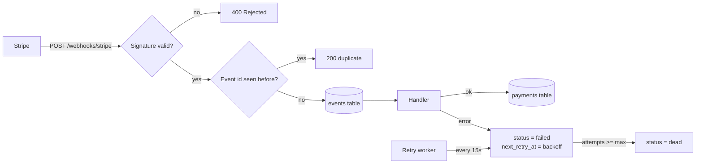

# Payment Webhook Service

A production-style Stripe webhook receiver built with **FastAPI** and **SQL**. It shows the parts most webhook integrations get wrong:

- ✅ **Signature verification**: HMAC-SHA256 over the raw body, constant-time compare, 5-minute replay window, secret rotation support. Implemented from Stripe's spec, with no SDK.
- ✅ **Idempotency**: Stripe can deliver the same event more than once. Each event id is stored once and processed once.
- ✅ **Automatic retries with exponential backoff**: if processing fails, the event is kept, Stripe still gets a `200`, and a background worker retries it (30s → 60s → 120s …). After `MAX_ATTEMPTS` it is marked `dead` for manual review.
- ✅ **Out-of-order protection**: an older event never overwrites newer payment state.
- ✅ **Atomic processing**: a handler that crashes halfway leaves no partial writes.
- ✅ **Ops endpoints**: health check, payment and event lists, manual retry, optional admin API key, Swagger docs.
- ✅ **22 automated tests**

## Architecture



The service answers `200` once the event is **durably stored**, so a downstream outage never triggers Stripe's own retry storm. Retries are handled here instead, where they are observable.

## Supported events

| Stripe event | Effect |
|---|---|
| `payment_intent.succeeded` | payment → `succeeded` |
| `payment_intent.payment_failed` | payment → `failed` |
| `charge.refunded` | payment → `refunded` / `partially_refunded`, stores refunded amount |
| anything else | stored and marked `ignored` |

New event types are one function plus one line in `HANDLERS` ([app/processor.py](app/processor.py)).

## Run locally

```bash
python -m venv .venv
.venv/Scripts/activate            # Windows  (macOS/Linux: source .venv/bin/activate)
pip install -r requirements-dev.txt

export STRIPE_WEBHOOK_SECRET=whsec_local_dev_secret   # PowerShell: $env:STRIPE_WEBHOOK_SECRET="whsec_local_dev_secret"
uvicorn --factory app.main:create_app --reload
```

Open http://127.0.0.1:8000/docs for the interactive API docs.

### Try it without a Stripe account

```bash
python scripts/send_test_event.py succeeded --event-id evt_demo   # 200 processed
python scripts/send_test_event.py succeeded --event-id evt_demo   # 200 duplicate (idempotency)
python scripts/send_test_event.py succeeded --bad-signature       # 400 signature mismatch
python scripts/send_test_event.py refunded --amount-refunded 1000 # partially_refunded
curl http://127.0.0.1:8000/payments
curl "http://127.0.0.1:8000/events?status=failed"
```

### With real Stripe test mode

```bash
stripe listen --forward-to localhost:8000/webhooks/stripe   # prints a whsec_... secret: use it as STRIPE_WEBHOOK_SECRET
stripe trigger payment_intent.succeeded
```

## Tests

```bash
pytest -q
```

They cover valid, tampered, wrong-secret, replayed and malformed signatures; secret rotation; duplicate delivery; unknown types; refunds; out-of-order delivery; retry with backoff; dead-lettering; rollback of partial writes; and admin auth.

## Configuration

| Variable | Default | Purpose |
|---|---|---|
| `STRIPE_WEBHOOK_SECRET` | (required) | Endpoint signing secret |
| `DB_PATH` | `webhooks.db` | SQLite file |
| `SIGNATURE_TOLERANCE` | `300` | Max age of a signed request (s) |
| `MAX_ATTEMPTS` | `5` | Attempts before an event is marked `dead` |
| `RETRY_BASE_SECONDS` | `30` | First backoff delay (doubles each attempt) |
| `RETRY_INTERVAL` | `15` | Retry worker poll interval (s), `0` = off |
| `ADMIN_API_KEY` | (unset) | If set, required as `X-Admin-Key` on `/payments`, `/events`, `/events/retry` |

## Production notes

SQLite keeps the demo dependency-free. The SQL is plain, so moving to PostgreSQL or MySQL is a driver swap. For multiple instances, run the retry worker in a single process or use `SELECT … FOR UPDATE SKIP LOCKED`. The same design also ports directly to **Laravel** (queued jobs) or **ASP.NET Core** (hosted service).

## Project layout

```
app/
  main.py        FastAPI app, routes, retry worker
  signature.py   Stripe signature verification
  processor.py   storage, idempotency, handlers, retry/backoff
  db.py          schema and connection helper
  config.py      env-based settings
scripts/send_test_event.py   signed fake events for local testing
tests/                       pytest suite
```
